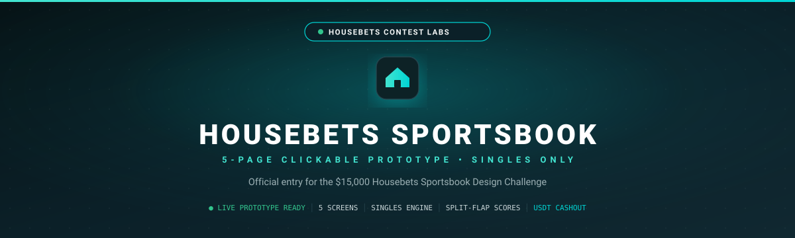

<div align="center">



<br />

[](https://housebet-steel.vercel.app/)
[](#-demo-data--responsible-use)
[](#-what-you-can-explore)
[](./LICENSE)

### A clearer, calmer way to explore a sportsbook.

Housebet is a **multi-sport, interactive sportsbook prototype** built around one idea: every price and bet state should be easy to understand.

[Launch the prototype](https://housebet-steel.vercel.app/) · [Explore the experience](#-what-you-can-explore) · [Run it locally](#-run-locally)

</div>

---

## Demo data & responsible use

> **Prototype only.** Fixtures, scores, clocks, odds, player details, wallet balance and bet outcomes are simulated in the browser. The demo uses USDT as a display currency; it does not connect to a wallet, accept real wagers, or handle real money. “Live” describes the match-screen presentation, not a live data feed.

## The idea

Sportsbook interfaces can make it hard to tell what a price means or why a bet cannot be placed. Housebet puts the match and its prices first, then explains changes in plain language: a market is suspended, odds moved, a selection failed, or a bet was accepted.

The interaction is designed to feel tangible: scoreboards flip, prices move, and the slip asks you to accept a changed price before continuing. Motion stays brief and purposeful so the important information remains in focus.

## What you can explore

- **Sports home and live listings** — browse upcoming and in-play demo fixtures, filter by sport and competition, and scan match prices.
- **Match centre** — view the scoreboard, grouped markets, price history, and team or player face-off details.
- **Singles bet slip** — add a selection, enter a USDT demo stake, review the accepted price and potential return, and place a simulated bet.
- **My Bets** — review open and settled demo bets, try a simulated cash-out, and open or export a shareable bet card.
- **Light and dark themes** — switch between the scoreboard-inspired palettes.
- **Responsive controls** — use horizontally scrollable sport and market filters, touch-sized actions, and a mobile bet-slip sheet.

### Sports represented

| Sport | Demo coverage |
| --- | --- |
| Football | Premier League, Champions League, LaLiga, Serie A, Bundesliga; match result, goals, halves, corners and cards |
| Basketball | NBA moneyline, spreads and totals |
| American football | NFL moneyline, spreads and totals |
| Baseball | MLB moneyline, run lines and totals |
| Ice hockey | NHL moneyline, puck lines and totals |
| Cricket | T20 match winner, runs and wickets |
| Tennis | Match winner, sets and games |
| MMA | Fight winner, method and round markets |

Team names and selected crests are used for visual context; the displayed fixtures and event data are not claims about real schedules or results.

## Try the demo states

Open a match and expand **Judge demo · try bet states** to create a 10 USDT demo single and explore the flow:

1. **Normal flow** — place a simulated bet and find it in My Bets.
2. **Odds changed** — review the previous and current prices, then accept the new price to continue.
3. **Suspend pick** — see why a selection is unavailable and remove it or wait for the market to reopen.
4. **Fail placement** — see a failed placement that preserves the stake so you can retry.

The floating **Demo** controls also let you simulate match events, shift odds, suspend a market, or switch the experience offline.

## Built with

React · TypeScript · Vite · Tailwind CSS · Lucide · `html-to-image`

The interface is client-side and uses local sample data. No sports-data API, account system, payment service, or wallet connection is required.

## Run locally

**Requirements:** Node.js `^20.19.0` or `>=22.12.0`.

```bash
git clone https://github.com/rajdeblol/Housebet-.git
cd Housebet-
npm install
npm run dev
```

Vite prints the local URL after startup. To create and preview a production build:

```bash
npm run build
npm run preview
```

## Project map

```text
src/
├── components/   Reusable navigation, match, market, bet-slip and share-card UI
├── data/         Demo fixtures, sports, competitions and team identities
├── engine/       Simulated scoring, odds movement, bet state and settlement logic
├── pages/        Sports home, live, sport hubs, match centre and My Bets
└── theme.ts      Shared brand and theme configuration
public/           Logos, team crests, banner and share-card artwork
```

## Credits

- Football crests are bundled from the [API-Sports football team-logo CDN](https://media.api-sports.io/football/teams/).
- IPL team names and marks are presented for visual demo context; team information is available at [iplt20.com/teams](https://www.iplt20.com/teams).
- Housebet is an independent design prototype created for the [Housebets Contest Labs sportsbook design contest](https://www.housebets.com/contests/sportsbook-design).

## License

Released under the [MIT License](./LICENSE).
